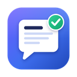
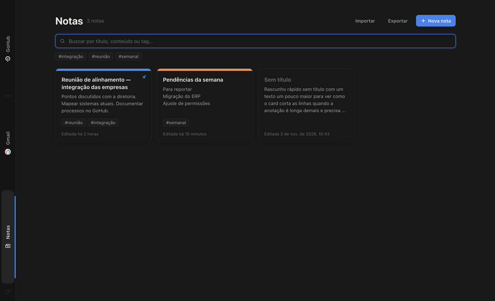
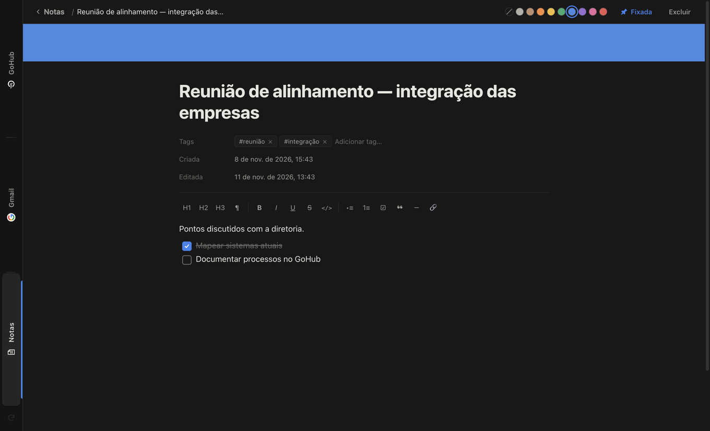

<p align="center">
  
</p>

<h1 align="center">Relato</h1>

<p align="center">
  GoHub, Gmail e Notas em uma única janela, para documentar tudo o que foi feito e o que será feito.<br>
  App interno para macOS e Windows. Sem instalação, sem servidor: tudo fica no seu computador.
</p>

---

## Sumário

1. [O que é](#o-que-é)
2. [Baixar](#1-baixar)
3. [Abrir no Windows](#2-abrir-no-windows)
4. [Abrir no macOS](#3-abrir-no-macos)
5. [Primeiro acesso: login](#4-primeiro-acesso-login)
6. [Usando as Notas](#5-usando-as-notas)
7. [Atalhos de teclado](#atalhos-de-teclado)
8. [Dúvidas frequentes](#dúvidas-frequentes)
9. [Para desenvolvedores](#para-desenvolvedores)

---

## O que é

O Relato tem três abas na barra lateral esquerda:

| Aba | Para que serve |
|---|---|
| **GoHub** | O portal onde reportamos as atividades (`gohub.goritektools.com`). |
| **Gmail** | O seu e-mail, onde chega o código de login do GoHub. |
| **Notas** | Um bloco de anotações em cards, no estilo Notion, para rascunhar o que vai ser reportado. |

O que faz diferença no dia a dia:

- **Trocar de aba não recarrega nada.** Você pode ir ao Gmail pegar o código e voltar ao GoHub, e a tela continua exatamente onde estava.
- **O login fica salvo.** Você não precisa entrar de novo toda vez que abrir o app. O Relato **não guarda senhas**, só a sessão (os mesmos "cookies" que um navegador guarda).
- **Um único login Google** vale para as duas abas.



---

## 1. Baixar

1. Acesse a página de versões do repositório: **[Releases](https://github.com/DevsNexus2024/relato-gohub/releases/latest)**.
2. Na seção **Assets**, baixe o arquivo do seu sistema:

| Sistema | Arquivo | Tamanho |
|---|---|---|
| **Windows** 10/11 (64 bits) | `Relato-<versão>-portable.exe` | ~110 MB |
| **macOS** 11 ou mais novo (Intel ou Apple Silicon/M1, M2…) | `Relato-<versão>-mac-universal.zip` | ~225 MB |

> O repositório é privado. Para baixar, você precisa estar logado no GitHub com uma conta que tenha acesso a ele. Se você não tiver acesso, peça o arquivo para quem administra o projeto.

---

## 2. Abrir no Windows

O Relato para Windows é **portátil**: não tem instalador.

1. Coloque o `Relato-…-portable.exe` onde preferir. Pode ser na Área de Trabalho ou em uma pasta `Programas` sua.
2. Dê **dois cliques** nele.
3. **Na primeira vez**, o Windows pode mostrar a tela azul do SmartScreen dizendo *"O Windows protegeu o computador"*. Isso acontece porque o app é interno e não tem assinatura digital paga. Para continuar:
   - clique em **Mais informações**;
   - depois clique em **Executar assim mesmo**.
4. Pronto. Nas próximas vezes, o aviso não aparece mais.

**Dicas:**

- Para fixar na barra de tarefas, abra o Relato, clique com o botão direito no ícone dele na barra e escolha **Fixar na barra de tarefas**.
- O `.exe` portátil se descompacta a cada abertura, então ele pode levar alguns segundos para abrir. Isso é normal.

---

## 3. Abrir no macOS

1. Dê dois cliques no `Relato-…-mac-universal.zip` para descompactar. Vai aparecer o **Relato.app**.
2. *(Recomendado)* Arraste o **Relato.app** para a pasta **Aplicativos**.
3. Dê dois cliques no **Relato.app**.
4. **Na primeira vez**, o macOS vai dizer que não pôde verificar o desenvolvedor. Isso acontece porque o app é interno e não passou pela Apple. Para liberar:
   - abra **Ajustes do Sistema → Privacidade e Segurança**;
   - role até o fim da página: vai aparecer *"O Relato foi bloqueado…"*. Clique em **Abrir Mesmo Assim** e confirme com sua senha do Mac;
   - abra o Relato de novo e clique em **Abrir**.
5. Pronto. Nas próximas vezes, ele abre direto.

<details>
<summary><b>Apareceu "O Relato está danificado e não pode ser aberto"?</b></summary>

Isso é só a quarentena do macOS em arquivos baixados da internet. Abra o app **Terminal** e cole este comando (ajuste o caminho se você não colocou o app em Aplicativos):

```bash
xattr -cr /Applications/Relato.app
```

Depois abra o Relato normalmente.
</details>

**Dicas:**

- Para deixar no Dock, abra o Relato, clique com o botão direito no ícone dele no Dock e escolha **Opções → Manter no Dock**.
- No Mac, fechar a janela (botão vermelho ou `⌘W`) só **esconde** o Relato, e as abas continuam como estavam. Para sair de verdade, use `⌘Q`.

---

## 4. Primeiro acesso: login

Faça o login **nesta ordem**, porque o código do GoHub chega no seu e-mail:

### a) Gmail

1. Clique na aba **Gmail** na barra lateral.
2. Entre com seu e-mail e senha do Google normalmente. Se tiver verificação em duas etapas, confirme no celular.
3. Pronto: o Gmail fica logado nas próximas aberturas.

### b) GoHub

1. Clique na aba **GoHub**.
2. Digite seu e-mail na tela **"Log in to GoHub"** e clique em **Send login code**.
3. Clique na aba **Gmail**, abra o e-mail com o código e copie o código.
4. Volte para a aba **GoHub**. A tela continua lá, esperando: é só colar o código.

> Quanto tempo o GoHub aceita antes de pedir um novo código é definido pelo administrador do GoHub, e não pelo Relato. O Relato guarda a sessão até ela expirar, então ele **não pede código a cada abertura do app**, só quando a sessão do GoHub vence.

### Botão de recarregar

O botão discreto **⟳** no rodapé da barra lateral recarrega **só a aba atual**. O mesmo atalho funciona no teclado: `Ctrl + R` no Windows ou `⌘ + R` no Mac. Use quando alguma página travar.

---

## 5. Usando as Notas

As notas servem para ir anotando ao longo do dia e depois passar tudo para o GoHub.



- **Criar:** clique em **+ Nova nota** ou use `Ctrl/⌘ + N`.
- **Abrir:** clique no card. A nota abre na própria tela, sem janela por cima. Para voltar, clique em **← Notas** ou aperte `Esc`.
- **Salvamento:** é automático. Não existe botão de salvar.
- **Título, tags e cor:** dê um título, adicione **tags** (digite e aperte `Enter`) e escolha uma **cor** nas bolinhas do topo. A cor aparece como faixa no card.
- **Fixar:** use **Fixar** para manter a nota sempre no início da lista.
- **Buscar:** a busca procura no título, no texto e nas tags. Clicar em uma `#tag` acima dos cards filtra só as notas com ela.
- **Prints:** copie um print (`Win + Shift + S` no Windows, `⌘ + Ctrl + Shift + 4` no Mac) e cole dentro da nota com `Ctrl/⌘ + V`. Também dá para arrastar uma imagem para dentro da nota.
- **Excluir:** clique em **Excluir** e depois clique **de novo** para confirmar.

### Formatação rápida (igual ao Notion)

No início de uma linha, digite o símbolo e depois **espaço**:

| Digite | Vira |
|---|---|
| `# ` | Título grande |
| `## ` | Título médio |
| `### ` | Título pequeno |
| `- ` | Lista com marcadores |
| `1. ` | Lista numerada |
| `[] ` | Checklist (clique na caixinha para marcar) |
| `> ` | Citação |

Também existe a barra de ferramentas acima do texto. Para abrir um link escrito na nota, use `Ctrl/⌘ + clique` nele.

### Backup das notas

As notas ficam **só no seu computador**. Para não perder nada:

- **Exportar** (no topo da tela de Notas) salva todas as notas em um arquivo `.json`.
- **Importar** traz as notas de um arquivo `.json`. Serve para restaurar um backup ou para levar suas notas para outro computador.

---

## Atalhos de teclado

| Ação | Windows | macOS |
|---|---|---|
| Ir para GoHub / Gmail / Notas | `Ctrl + 1` / `2` / `3` | `⌘ + 1` / `2` / `3` |
| Recarregar a aba atual | `Ctrl + R` | `⌘ + R` |
| Recarregar ignorando o cache | `Ctrl + Shift + R` | `⌘ + Shift + R` |
| Nova nota | `Ctrl + N` | `⌘ + N` |
| Buscar nas notas | `Ctrl + F` | `⌘ + F` |
| Voltar para a lista de notas | `Esc` | `Esc` |
| Zoom + / − / normal | `Ctrl + =` / `-` / `0` | `⌘ + =` / `-` / `0` |

---

## Dúvidas frequentes

**Onde ficam meus dados?**
No menu **Arquivo → Abrir pasta de dados**. Os caminhos são:
- Windows: `%APPDATA%\Relato\`
- macOS: `~/Library/Application Support/Relato/`

As notas ficam no arquivo `notes.json` dessa pasta.

**Como saio das contas, ou deixo o app "zerado"?**
Feche o Relato e apague a pasta de dados acima. Na próxima abertura, ele começa do zero. Antes disso, **exporte as notas** se quiser guardá-las.

**Um link de e-mail abriu no meu navegador, e não no Relato. É normal?**
Sim. Links para sites de fora abrem no seu navegador padrão. Só as janelas de login (Google, GoHub) abrem dentro do Relato.

**O Google disse que o navegador não é seguro.**
Isso não deveria acontecer, porque o Relato se apresenta como um Chrome comum. Se acontecer, avise quem administra o projeto e mande um print da tela.

**Preciso atualizar o Relato?**
Quando sair uma versão nova em [Releases](https://github.com/DevsNexus2024/relato-gohub/releases), baixe e substitua o arquivo antigo. Seus logins e notas **não se perdem**, porque ficam na pasta de dados e não no executável.

---

## Para desenvolvedores

Requisitos: Node.js 20 ou mais novo.

```bash
npm install
npm start          # roda em modo desenvolvimento
```

### Gerar os executáveis

```bash
npm run dist:mac   # dist/Relato-<versão>-mac-universal.zip  (Intel + Apple Silicon)
npm run dist:win   # dist/Relato-<versão>-portable.exe        (Windows x64, portátil)
npm run dist       # os dois de uma vez (funciona a partir de um Mac)
```

Para publicar uma versão nova: aumente o `version` no `package.json`, gere os arquivos e crie uma Release no GitHub anexando o `.zip` e o `.exe`.

### Estrutura

```
src/main.js            processo principal: janela, abas (WebContentsView), sessão, menu
src/preload.js         ponte segura entre a interface e o processo principal
src/renderer/          barra lateral e tela de Notas (HTML/CSS/JS puro)
scripts/make-icon.js   gera build/icon.png a partir de um SVG  (npm run icon)
scripts/snapshot.js    teste visual: tira screenshots de cada aba
build/icon.png         ícone usado nos executáveis
```

### Como alterar

- **Trocar ou adicionar sites:** edite a lista `SITES` no topo de `src/main.js`.
- **Tempo que a sessão fica salva:** `SESSION_COOKIE_DAYS` em `src/main.js` (padrão: 30 dias).
- **Rotação do favicon nas abas:** variável `--fav-rotate` em `src/renderer/styles.css`.

### Decisões técnicas

- **Por que Electron:** é Chromium completo e funciona igual no Windows e no macOS. O WebView nativo de cada sistema (WKWebView/WebView2) costuma ser bloqueado no login do Google.
- **User-Agent:** o app usa o de um Chrome comum, sem o termo "Electron", para o Google aceitar o login.
- **Sessão única e persistente:** a partição `persist:workspace` é compartilhada pelas duas abas. Cookies de sessão são convertidos em persistentes para o login sobreviver ao fechamento do app.
- **Sem refresh ao trocar de aba:** cada site é uma `WebContentsView` que só fica visível ou invisível. Elas também rodam com `backgroundThrottling: false`, para timers continuarem funcionando em segundo plano.
